<h1 align="center">Hi 👋, I'm Arsh!</h1>

  

<h3 align="center">🚀 Tech Enthusiast | 💻 Full-Stack Developer | 🎯 Lifelong Learner</h3>

  <!-- Minimal monochrome trophies (professional, no heavy colors) -->
  

  

- 🔭 I’m currently working on **AI, Cloud, Secuity Projects**

- 👨‍💻 All of my projects are available at [https://arshdev.in](https://arshdev.in/)






<a href="https://github.com/arshc0der/myOS"></a>

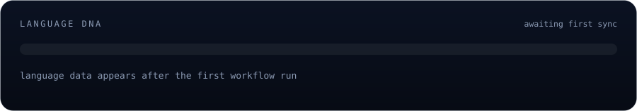


 
<!--GitHub Stats -->

 
 

---
